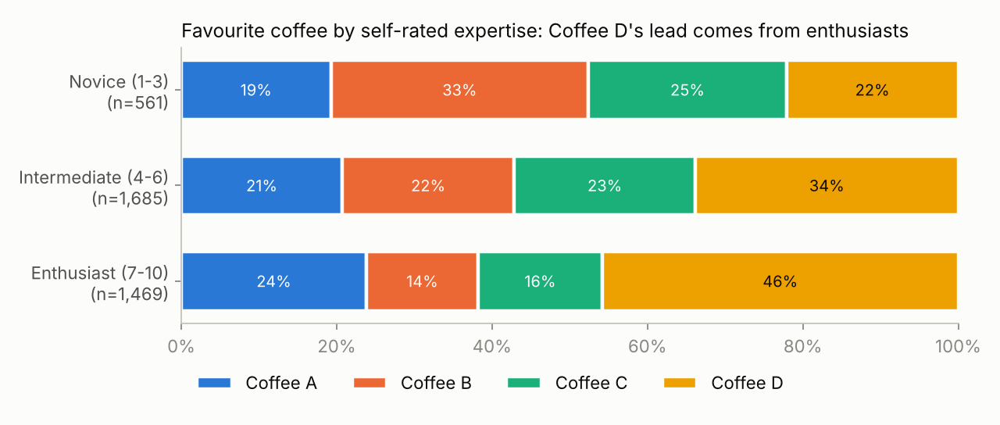

# Coffee Consumer Survey Insights

**Should the taste-test winner lead a mainstream launch?** This project is an end-to-end consumer-insights analysis of a 4,042-respondent public consumer survey, the *Great American Coffee Taste Test* (Oct 2023). It takes the work from raw survey data to an executive insight memo and a questionnaire review.

## Headline

Coffee D won with 37% of first choices, but the win comes from enthusiasts: 46% of enthusiasts picked it, against 22% of novices. Among non-enthusiasts who don't drink coffee black, **D comes last (21%)**. The memo recommends positioning D as a premium enthusiast product and validating it with a representative, randomised-order follow-up.

→ [Insight memo](reports/insight_memo.md) · [Questionnaire review](reports/questionnaire_review.md)



## What's in it

| Step | What it does | Where |
|---|---|---|
| Data pipeline | Raw CSV → typed DuckDB staging table with data-quality flags (under-18s, incomplete tasting, straight-lining, inconsistent forced choice, duplicate IDs) → analysis marts and an exclusion waterfall | `sql/`, `src/pipeline.py` |
| Survey QA | Section-level completion/breakoff rates; 4,042 → 3,716 analysis base | `mart_exclusions`, `mart_completion` |
| Cross-tabs & tests | Favourite coffee by expertise and gender; chi-square, Cramér's V, two-proportion CI | `src/analysis.py` |
| Drivers | Logistic regression on picking Coffee D (expertise, gender, age, black coffee) | `src/analysis.py` |
| Weighting | Raking (iterative proportional fitting) with trimming and Kish effective sample size, used as a sensitivity test on the sample's gender skew | `src/survey_tools.py` |
| Segmentation | k-means taste-profile segments on four preference ratings, profiled by expertise, gender and willingness to pay | `src/analysis.py` |
| Qualitative | Multi-label keyword codeframe on open-ended tasting notes, comparing likers and dislikers | `src/survey_tools.py` |
| Reporting | One-page insight memo for a non-technical reader; questionnaire critique with fixes | `reports/` |
| Tests | 13 pytest tests (pipeline integrity, scale ranges, exclusions, raking, ESS, coding) | `tests/` |

## Run it

```bash
pip install -r requirements.txt
python src/pipeline.py      # builds outputs/coffee_survey.duckdb
python src/analysis.py      # writes outputs/results.json and reports/figures/
python -m pytest -q
```

## Data

The data is the [Great American Coffee Taste Test](https://github.com/rfordatascience/tidytuesday/tree/main/data/2024/2024-05-14) survey run by James Hoffmann and Cometeer, as published by TidyTuesday (`data/raw/coffee_survey.csv`). The coffees were served blind as A–D. Respondents self-selected from a YouTube audience, so results are directional, not nationally representative.

## Notes

Built with AI assistance (Claude); I reviewed and validated the analysis, numbers and conclusions.
